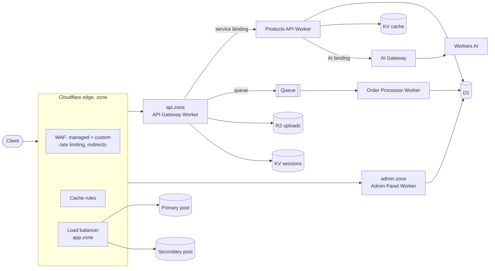

# Cloudflare Demo Platform (Terraform, provider v5)

> ⚠️ **NOT OFFICIAL CLOUDFLARE.** Not affiliated with or endorsed by Cloudflare, Inc.
> NO WARRANTIES, EXPRESS OR IMPLIED. Effectively untested demo code — read everything
> and dry-run before you run. You assume all risk. See [DISCLAIMER.md](./DISCLAIMER.md).

One Terraform root module that stands up a small e-commerce backend on
Cloudflare and puts the full edge stack in front of it: WAF (managed, custom,
rate limiting), CDN cache rules, load balancing with failover, Workers with
every common binding type, and Workers AI through AI Gateway. Built on the
**Cloudflare Terraform provider v5** (`~> 5.0`).

## Find your topic

Everything is one deployable module, but each topic lives in its own file.
Read that file plus its test to see the whole pattern.

| You care about | File | What it shows | Test (`tests/main.tftest.hcl`) |
|---|---|---|---|
| **WAF, managed rules** | [`waf.tf`](./waf.tf) | Cloudflare Managed + OWASP Core rulesets (official IDs), and a path-scoped **skip exception** for OWASP 949110 on `/admin`, placed before the execute rules | `waf_managed_ruleset` |
| **WAF, custom rules** | [`waf.tf`](./waf.tf) | Block scanner paths, challenge empty user agents, challenge `/admin` outside an IP allowlist | `waf_custom_ruleset` |
| **Rate limiting** | [`waf.tf`](./waf.tf) | Per-IP + per-colo limit on `/api/*` (50 req / 10 s, 60 s block) | `waf_rate_limit_ruleset` |
| **Redirects** | [`waf.tf`](./waf.tf) | Single redirect, plus a commented "force HTTPS" toggle | `waf_redirects` |
| **CDN / cache** | [`cdn.tf`](./cdn.tf) | Cache rules (bypass the API, edge-TTL the admin shell) and v5 per-setting `cloudflare_zone_setting` | `cache_rules`, `zone_settings` |
| **Load balancing** | [`load_balancer.tf`](./load_balancer.tf) | One HTTP monitor, **two pools**, active/passive failover, and a variable that drains the primary live | `load_balancer_stack`, `load_balancer_failover_toggle` |
| **Workers (v5 pattern)** | [`workers.tf`](./workers.tf), [`routes.tf`](./routes.tf) | `cloudflare_worker` + `cloudflare_worker_version`; KV, R2, D1, Queue, service, AI, plain-text and **secret** bindings; Workers Logs | `worker_bindings`, `worker_routes`, `admin_password_is_a_secret_binding` |
| **AI Gateway** | [`ai-gateway.tf`](./ai-gateway.tf) | Gateway with caching, retries and logging; a Worker calls Workers AI through it | `ai_gateway` |
| **Storage + queues** | [`storage.tf`](./storage.tf), [`queue-consumer.tf`](./queue-consumer.tf) | D1, KV, R2, Queue, and a first-class `cloudflare_queue_consumer` | `storage_resources`, `queue_consumer` |
| **v4 → v5 upgrade** | [`upgrade-from-v4.tf`](./upgrade-from-v4.tf) | `moved` blocks that rename DNS records in place (verified), and the `removed` + `import` route for Workers, which can't be moved across types | — |

Every ruleset rule sets a `ref`, so rule IDs stay stable when you edit a
ruleset ([why](https://developers.cloudflare.com/terraform/troubleshooting/rule-id-changes/)).

## Reading the Terraform

Terraform loads every `.tf` file in the folder as one configuration. File
names are only for people. Read them in this order; each file starts with a
short header naming the Terraform concept it shows.

| # | File | Terraform concept |
|---|---|---|
| 1 | [`providers.tf`](./providers.tf) | Pinning Terraform and the provider; credentials from the environment |
| 2 | [`variables.tf`](./variables.tf) | Inputs, defaults, `validation`, `sensitive` |
| 3 | [`zone.tf`](./zone.tf) | Data source: read something Terraform doesn't manage |
| 4 | [`storage.tf`](./storage.tf) | Plain resources with no dependencies |
| 5 | [`workers.tf`](./workers.tf) | References between resources, a `local`, a secret from a sensitive variable |
| 6 | [`routes.tf`](./routes.tf), [`queue-consumer.tf`](./queue-consumer.tf), [`dns.tf`](./dns.tf) | Wiring resources together by reference |
| 7 | [`waf.tf`](./waf.tf), [`cdn.tf`](./cdn.tf) | One resource type (`cloudflare_ruleset`) used per phase; stable `ref`s |
| 8 | [`load_balancer.tf`](./load_balancer.tf) | A boolean variable that changes live behavior |
| 9 | [`ai-gateway.tf`](./ai-gateway.tf), [`outputs.tf`](./outputs.tf) | Outputs |
| 10 | [`migrations.tf`](./migrations.tf) | Provisioners: the last-resort escape hatch |
| 11 | [`upgrade-from-v4.tf`](./upgrade-from-v4.tf) | `moved`, `removed`, `import`: changing addresses without destroying things |
| 12 | [`tests/main.tftest.hcl`](./tests/main.tftest.hcl) | `terraform test` with a mocked provider |

**How Terraform decides the order.** Nothing here says "create the
database, then the Worker". The Worker refers to
`cloudflare_d1_database.products.id`, so Terraform must create the database
first. Every reference is an edge in a dependency graph, and Terraform
creates independent resources in parallel. `terraform graph` draws it.

**The loop you'll use:**

```bash
terraform init      # download the provider pinned in providers.tf
terraform plan      # compare config with state and show the diff; changes nothing
terraform apply     # make the diff real and record the result in terraform.tfstate
terraform destroy   # delete everything in state (the zone is a data source, so it stays)
```

## Architecture



## Quick start

### Prerequisites
- Terraform >= 1.9 (tested with 1.17), [Wrangler](https://developers.cloudflare.com/workers/wrangler/install-and-update/) (applies the D1 schema), Python 3 (empties R2 at destroy)
- An existing zone in your Cloudflare account

### Token permissions

| Scope | Permission |
|---|---|
| Account | Workers Scripts, Workers KV Storage, Workers R2 Storage, D1, Queues, AI Gateway, Load Balancing: Monitors and Pools — all **Edit** |
| Zone | Zone Settings, DNS, Workers Routes, Cache Rules, Zone WAF, Load Balancers — all **Edit** |

### Configure

Credentials come from the environment, never from files:

```bash
export CLOUDFLARE_API_TOKEN=<token>          # provider, wrangler, R2 cleanup
export TF_VAR_admin_password=<12+ chars>     # stored as a Worker secret
cp terraform.tfvars.example terraform.tfvars # account_id, zone_name (gitignored)
```

### Verify, deploy, tear down

```bash
make verify    # offline: lint, config guards, fmt, validate, 25 mocked tests
make deploy    # terraform apply + smoke checks
make test      # integration suite against the deployed platform
make destroy   # empties R2, then destroys everything
```

The zone itself is a data source; destroy never deletes it.

## Demos

**Platform:** `make deploy-demo` runs sample API calls. `make latency` compares
KV-cache HIT and MISS latency. `make analytics` generates traffic for the
Workers dashboards. The admin panel is at `https://admin.<zone>` (user
`admin`, your `admin_password`). Click **Load Sample Data** first.

**WAF and rate limiting:**
```bash
curl -i https://api.<zone>/.env                                       # custom rule: 403
curl -i -A "" https://api.<zone>/api/products                         # empty UA: challenged
for i in $(seq 60); do curl -s -o /dev/null -w "%{http_code} " https://api.<zone>/api/products; done   # 429s after 50
```

**Load balancer failover:**
```bash
terraform apply -var primary_origin_enabled=false   # drain primary; app.<zone> moves to secondary
terraform apply                                     # restore
```
The default origins are RFC 5737 documentation addresses, so the monitor
reports every pool unhealthy and traffic goes to the fallback pool. Set
`origin_ipv4` and `secondary_origin_ipv4` to real origins that serve `/health`
to show healthy failover.

**AI Gateway:** `curl https://api.<zone>/api/products/summary` summarizes the
catalog with Workers AI through `demo-ai-gateway`. A repeat call is a gateway
cache hit, visible under **AI → AI Gateway → Logs**.

**Terraform concepts:** `./scripts/demos/terraform-demo.sh <demo>` runs one of
`state-inspect`, `drift-detect`, `idempotency`, `targeted`, `plan-file`,
`refresh-only`, `taint-replace`, `var-override`, `graph` or `workspaces`.
`make tf-all` runs them all.

Every user-facing `.sh` script has a matching `.ps1`.

## API

| Method + path (`https://api.<zone>`) | Purpose |
|---|---|
| `GET /api/products`, `GET /api/products/{id}` | List (KV-cached, `X-Products-Cache: HIT/MISS`) and fetch |
| `POST`/`PUT`/`DELETE /api/products[/{id}]` | Create, update, delete (invalidates the cache) |
| `POST /api/products/seed` | Load 5 sample products |
| `GET /api/products/summary` | AI catalog summary through AI Gateway |
| `POST /api/orders` | Queue an order for async processing |
| `POST /api/upload` (multipart `file`) | Store a file in R2 |
| `POST /api/auth/login`, `GET /api/auth/me` | Demo session auth (accepts any credentials) |

Admin (`https://admin.<zone>`, Basic auth): `/`, `/api/stats`, `/api/products`, `/api/orders`, `POST /setup`.

## Design notes: read before you copy

This is a demo, and a few choices are deliberate shortcuts:

- **Worker code is deployed by Terraform** to keep everything in one apply.
  Many teams deploy Worker code with Wrangler in CI and keep Terraform for the
  surrounding infrastructure (routes, storage, rulesets). Both are valid.
- **Two `local-exec` provisioners** fill API gaps: applying the D1 schema
  (wrangler), and emptying R2 before destroy, since v5 has no force-destroy.
  HashiCorp treats provisioners as a last resort, so don't copy this pattern
  where a resource exists.
- **State is local.** For shared use, add a remote backend, for example the S3
  backend pointed at R2:
  ```hcl
  terraform {
    backend "s3" {
      bucket = "tf-state"
      key    = "demo-platform/terraform.tfstate"
      region = "auto"
      endpoints                   = { s3 = "https://<account_id>.r2.cloudflarestorage.com" }
      skip_credentials_validation = true
      skip_region_validation      = true
      skip_requesting_account_id  = true
      skip_s3_checksum            = true
      use_path_style              = true
    }
  }
  ```
- **Demo auth.** The API's login accepts any credentials. The admin panel uses
  one Basic-auth password from a secret binding, compared in constant time. Put
  [Cloudflare Access](https://developers.cloudflare.com/cloudflare-one/applications/)
  in front of anything real.

## Testing

- **`make verify`** (offline, no credentials, mirrored in CI by
  [`.github/workflows/verify.yml`](./.github/workflows/verify.yml)) runs four checks:
  - shellcheck, shfmt, and JS/Python syntax checks.
  - Config guards in `scripts/tests/config-checks.sh`: official WAF IDs, the commented HTTPS toggle, no hardcoded admin password, tests stay on `plan`.
  - `terraform fmt` and `terraform validate`.
  - **25 mocked `terraform test` cases**, including negative tests that prove each input validation fires.
- **`make test` / `make smoke`** run integration checks against a deployed
  platform (`scripts/tests/test.sh`, `.ps1`).

The mocked tests show the configuration says what it should. They can't show
the API accepts it, for example whether a rule expression parses. Only a real
`plan`/`apply` checks that.

## Troubleshooting

| Symptom | Fix |
|---|---|
| `Authentication error` (10000) on rulesets / LB / AI | The token is missing that permission; see the table above |
| After upgrading from v4, plan shows DNS records being destroyed | A `moved` block doesn't match your state; compare it with `terraform state list` |
| After upgrading from v4, plan fails with "Unable to Move Resource State" | Workers can't be `moved` across types; use `removed` + `import` (see `upgrade-from-v4.tf`) |
| Worker returns `error code: 1101` | Uncaught exception: `wrangler tail demo-api-gateway`, or check the Worker's Logs tab |
| Admin panel says the database isn't initialized | Re-run `terraform apply` (schema step), or `POST /setup` on the admin panel |
| `/api/products/summary` returns 503 | Workers AI isn't available on the account |
| Destroy fails on the R2 bucket | `CLOUDFLARE_API_TOKEN` wasn't set in the shell running destroy |

## Cost

The zone is pre-existing. A demo session stays well inside the Workers, D1,
KV, R2 and Queues free tiers. Load balancing and some WAF features depend on
your plan.

## License

MIT; see [LICENSE](./LICENSE) and [DISCLAIMER.md](./DISCLAIMER.md).
